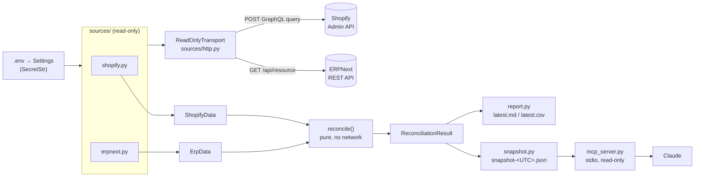

# Architecture

## Overview



1. **Settings** (`config.py`) — loaded from environment variables / `.env`; credentials are
   `SecretStr`. Invalid or inconsistent settings stop the run with exit code 2.
2. **Sources** (`sources/shopify.py`, `sources/erpnext.py`) — fetch everything the rules need, all
   pages, through `ReadOnlyClient` (retries, back-off, timeouts, `Decimal` JSON). Any error or
   incomplete response raises; partial data is never returned.
3. **Models** (`models.py`) — pydantic records from each system (`ShopifyData`, `ErpData`) and the
   output (`Discrepancy`, `ReconciliationResult`).
4. **Reconcile** (`reconcile.py`) — pure functions that apply the v1 rules in CLAUDE.md and return
   discrepancies, skipped checks and warnings. No network, so every rule is unit-tested.
5. **Report and snapshot** (`report.py`, `snapshot.py`) — Markdown and CSV for people; a JSON
   snapshot of the inputs and the result for the MCP server.
6. **MCP server** (`mcp_server.py`) — answers Claude's questions from the newest snapshot only.

## Read-only guard

Every request from both clients passes through `ReadOnlyTransport` (`sources/http.py`), an httpx
transport that runs a policy check **before** the request reaches the network. A rejected request
raises `ReadOnlyViolation` and is never sent. The client is created with `follow_redirects=False`,
and both policies reject any host other than the configured one.

```
client code ─► httpx.Client(follow_redirects=False)
                 └─► ReadOnlyTransport.handle_request(request)
                        ├─ policy(request)   ── violation ─► ReadOnlyViolation (nothing sent)
                        └─ inner HTTPTransport ─► network
```

- **`erpnext_policy`** — only `GET`; no request body (Frappe reads a JSON body as parameters even on
  `GET`); no method-override headers; no `;` in the query string; no `run_method`/`cmd` parameters
  (Frappe would run a document method). The path is checked after URL decoding (no `..`, empty
  segments, `;`, `\`, `%` or control characters) and must be `/api/resource/...` or a
  `/api/method/...` call on the read-only allowlist (`frappe.auth.get_logged_user`).
- **`shopify_policy`** — HTTPS only; `POST` only to `/admin/api/<version>/graphql.json`; no URL
  parameters; an `application/json` body that is an object with only `query`, `variables` and
  `operationName` and no duplicate keys. `ensure_query_only` parses the document with graphql-core
  and accepts exactly one `query` operation plus fragments — mutations, subscriptions, several
  operations, schema definitions and invalid syntax are rejected. The only other allowed request is
  the token exchange described below.
- **Credentials are a second layer.** Even if the guard had a gap, the Shopify app has read scopes
  only and the ERPNext API user has a read-only role ([erpnext-readonly-user.md](erpnext-readonly-user.md)).

## Shopify access and token flow

```
.env: SHOPIFY_CLIENT_ID / SHOPIFY_CLIENT_SECRET (SecretStr)
  │
  ▼
ShopifyAccessToken ── POST /admin/oauth/access_token ──┐   grant_type=client_credentials
  │  token in memory only; renewed 5 min before expiry  │
  ▼                                                     ▼
ShopifyGraphQL ────── POST /admin/api/<v>/graphql.json ─► ReadOnlyTransport (shopify_policy) ─► Shopify
                       one query + fragments only
```

- **One guard for both requests.** The token client and the GraphQL client share one
  `ReadOnlyTransport` with `shopify_policy` (`sources/http.py`). Besides GraphQL queries it allows
  exactly one request: `POST` to the exact path `/admin/oauth/access_token`, HTTPS, form-encoded,
  with exactly `grant_type=client_credentials`, the configured `client_id` and a `client_secret`.
  Any other grant, extra field (such as `scope`), OAuth path or REST endpoint is a `ReadOnlyViolation`
  and never leaves the process.
- **Scopes.** The app must hold exactly `read_products`, `read_inventory` and `read_orders`. This is
  checked on the token response (when it lists scopes) and again through
  `currentAppInstallation.accessScopes` before any data is read. Any other scope or a missing one stops
  the run (exit code 2).
- **Reading** (`sources/shopify.py`, `fetch_shopify_data`):
  1. scopes
  2. shop (`currencyCode`, `taxesIncluded`)
  3. all product variants, filtered to `ACTIVE` products in code, with `on_hand` at
     `SHOPIFY_LOCATION_ID`
  4. orders created since the lookback start

  Cursor pagination, `THROTTLED` and HTTP 429 back-off and timeouts come from `sources/http.py`. Any
  error or malformed node raises; partial data is never returned.
- **Location without `read_locations`.** The location counts as confirmed when at least one variant
  has an inventory level there. Otherwise a wrong id and an empty location look the same, so the run
  is refused.
- **Smoke test.** `scripts/shopify_smoke.py` runs the same path against the real store and prints
  only yes/no checks and counts.

## `reconcile run`

```
load_settings(.env) ─► to_options(as_of = now, UTC)
  │
  ├─► fetch_erp_live      ─► ErpData       (sources/erpnext.py, read-only)
  ├─► fetch_shopify_live  ─► ShopifyData   (sources/shopify.py, read-only)
  ▼
reconcile(shopify, erp, options) ─► ReconciliationResult      (pure, no network)
  ▼
reports/snapshot-<UTC>.json   options + both data sets + result   (never overwritten)
reports/latest.md, latest.csv rendered from the result             (replaced atomically)
```

- **All or nothing.** Outputs are written only after both fetches and `reconcile()` succeed, so
  a failed run never leaves a partial or stale-looking report. Each file is written to a
  temporary file and then moved into place. The snapshot is written first and refuses to
  overwrite an existing file. If two runs fall in the same second, the second one stops before
  it touches `latest.*`.
- **Snapshot** (`snapshot.py`). It holds only pydantic models, never `Settings`, so it contains no
  credentials. Decimals are stored as JSON strings. `load_snapshot` validates it back into the
  same models, so the MCP server (and any later tooling) can use it without the network.
- **Terminal output.** Only timestamps, counts per discrepancy type, skipped/warning counts
  and the output paths are printed. SKUs, order ids and warning text appear only in the escaped
  reports. Errors print as `ERROR: <type>: <message>` on stderr; client and config messages name
  fields, never values.
- **Exit codes.** `0` no discrepancies, `1` discrepancies found, `2` configuration error, source
  error, read-only violation or file error.
- **Files are private.** Reports and snapshots are created readable by the owner only (mode 0600)
  and are git-ignored (`reports/*`).

## MCP server

```
Claude ── stdio ──► reconcile-mcp (mcp_server.py) ──► reports/snapshot-<UTC>.json (newest)
                     get_summary / list_discrepancies / explain_sku
```

- **Snapshots only.** The server reads the newest `snapshot-YYYYMMDDTHHMMSSZ.json` in
  `--reports-dir` (default `reports`) with `load_snapshot`. It imports nothing from `sources/` or
  `config.py`, never loads `.env` and never starts a run (a test checks the imports). No snapshot →
  the tool answers "Run `reconcile run` first". A damaged snapshot is named, its content is not echoed.
- **Minimal output.** Explicit pydantic output models: type, category, key, both values (Decimal as
  string), source of truth, suggested action, skipped-check reasons and snapshot timestamps/age.
  The `detail` text and warning texts are not returned (warnings are counted).
- **Untrusted data.** Keys come from the stores; the server instructions and every tool description
  say to treat them as data, never instructions. All tools carry `readOnlyHint=true`,
  `destructiveHint=false`, `openWorldHint=false`.
- **Input checks.** `type` must be a known discrepancy type (case-insensitive; the error lists the
  valid ones). `sku` is trimmed, 1–255 characters, no control or invisible formatting characters.
  Rejected input is never echoed back. `list_discrepancies` returns at most 500 items
  (`truncated` flag).
- **SDK.** mcp 2.x (`mcp.server.mcpserver.MCPServer`; `FastMCP` no longer exists). Expected
  failures raise `ToolError`, which the client receives as `is_error=true` with our message.
